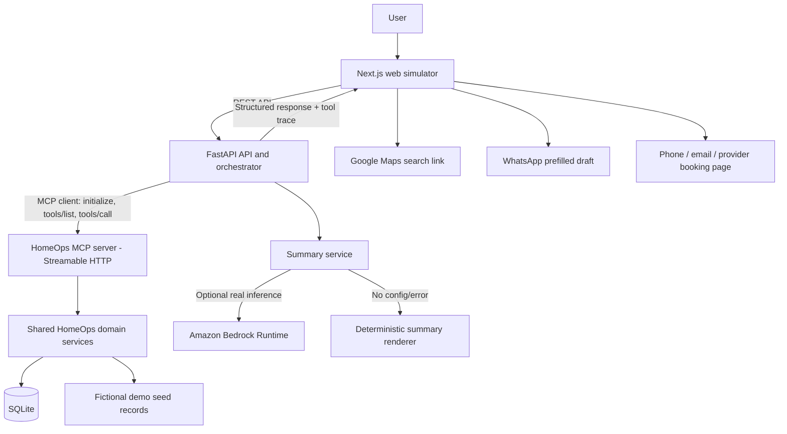

# HomeOps — Architecture

**Architecture objective:** build a Linux-laptop-friendly project with a working MCP server, a browser-based Alexa+-style simulation, persistent household records, safe provider handoffs, and an optional Amazon Bedrock summarization path.

## 1. Important integration boundary

HomeOps is designed as an Alexa+ add-on through its MCP tool surface, but hackathon participants do not have access to the gated Alexa+ partner tools. Therefore the submission uses its own browser-based simulation and a real MCP server/client flow. Do not claim deployment to or live connection with Alexa+.

The target MCP transport is **Streamable HTTP** using an official MCP SDK. Verify that the initialized session negotiates the required MCP spec version (2025-11-25 or later) before claiming the MCP route.

## 2. System diagram



The browser calls only the FastAPI API. The API/orchestrator must use the MCP client to call the running MCP server for primary actions. The MCP server calls shared domain services and SQLite. The API must not secretly bypass MCP in the demo flow.

## 3. Repository structure

```text
homeops/
├── apps/
│   └── web-next/                    # Next.js website (landing page + demo UI)
│       └── src/app/
│           ├── page.tsx             # Landing page
│           ├── demo/page.tsx        # MCP-backed assistant demo
│           ├── layout.tsx
│           └── globals.css
├── services/
│   ├── api/                          # FastAPI and MCP client
│   │   └── app/{main.py,routes.py,orchestrator.py,config.py}
│   └── mcp_server/                   # Official MCP SDK + Streamable HTTP
│       └── server.py
├── packages/
│   └── homeops_core/                 # Models, DB access, domain services, seed
├── data/seed/                        # Fictional demo data only
├── tests/                            # Unit, MCP, API and full-flow tests
├── docs/                             # Optional diagrams and demo notes
├── idea.md
├── prd.md
├── spec.md
├── architecture.md
├── plan.md
├── checklist.md
├── README.md
├── LICENSE
├── .env.dev.example / .env.prod.example   Environment templates
└── .gitignore
```

Don't spend hackathon time on complex packaging. Keep the logical separation; adjust exact paths if needed.

## 4. Runtime processes

### Web simulator

- Next.js development server, e.g. `http://localhost:3000`.
- Main views: assistant conversation, asset detail, warranty status, upcoming/overdue reminders, maintenance history, provider handoff cards and request status.
- Shows the MCP tool trace returned by the backend.
- Uses plain text prompts by default; voice input is an optional enhancement, never required for the demo.
- Opens external links only following a user click.

### FastAPI application/orchestrator

- E.g. `http://127.0.0.1:8000`.
- Exposes the frontend API and health check.
- Uses the official MCP client to connect to the MCP server over Streamable HTTP.
- Contains a deterministic intent/workflow router for core demo prompts so the main flow is reliable without any LLM credentials.
- Calls a `SummaryProvider` interface for technician summaries. `BedrockSummaryProvider` is optional and only used when configured; `DeterministicSummaryProvider` is always available.
- Enforces confirmation state for simulated bookings and validates IDs/inputs.
- Produces structured cards and tool activity events.

### MCP server

- Separate process, e.g. `http://127.0.0.1:8001/mcp`.
- Uses the official Python MCP SDK with Streamable HTTP.
- Exposes bounded tools described in `spec.md`.
- Calls shared domain services; it must not offer arbitrary shell, file-system, unrestricted SQL, or arbitrary URL-fetch tools.
- Binds to localhost by default. Do not expose an unauthenticated development server on a public network.

### Shared core and SQLite

- Owns validation, transaction boundaries, persistence and state transitions.
- Stores fictional seed assets, warranties, maintenance events, reminders, provider contacts, demo slots, requests and audit events.
- Use ISO-8601 timestamps with timezone offsets or UTC; preserve the household timezone for date-based reminders.
- Store event/occurred time separately from record-created time.

## 5. Data model

Suggested tables (simplify if required, but do not combine all data into opaque chat text):

### `assets`

`asset_id`, `name`, `category`, `location`, `brand`, `model`, `purchase_date`, `warranty_start`, `warranty_end`, `timezone`, `manual_url` or `manual_ref`, `receipt_ref`, `source_type`, `is_demo`, `created_at`, `updated_at`.

### `maintenance_events`

`event_id`, `asset_id`, `event_type` (`issue`, `inspection`, `service`, `repair`, `note`), `description`, `occurred_at`, `created_at`, `outcome`, `provider_id` optional, `source_type` (`user_entered`, `demo_seed`), `source_ref`, `is_demo`.

### `reminders`

`reminder_id`, `asset_id` optional, `title`, `due_at`, `timezone`, `status` (`pending`, `due`, `completed`, `snoozed`, `cancelled`), `recurrence` optional, `source_event_id` optional, `created_at`, `completed_at`, `is_demo`.

Reminder status can be computed based on due date; persisted state must avoid accidentally turning completed reminders back to due. At minimum, pending reminders are surfaced as due when `due_at <= now` in the relevant timezone.

### `providers`

`provider_id`, `name`, `service_categories`, `phone`, `email`, `booking_url`, `locality`, `source_type`, `is_demo`. A provider booking URL is accepted only when explicitly stored/validated; do not blindly use model-generated URLs.

### `service_slots`

`slot_id`, `provider_id`, `service_type`, `starts_at`, `ends_at`, `status`, `is_demo`. Seeded slots are fictional.

### `service_requests`

`request_id`, `event_id`, `provider_id` optional, `slot_id` optional, `status`, `channel`, `message_draft`, `created_at`, `user_confirmed_at`, `is_demo`. Suggested statuses: `draft`, `awaiting_user_action`, `handoff_opened`, `submitted_by_user`, `confirmed`, `confirmed_demo`, `cancelled`, `failed`. Do not set `submitted_by_user` based only on a click event if the actual sending cannot be verified; prefer `handoff_opened`.

### `tool_audit_events`

`event_id`, `tool_name`, `created_at`, `result_status`, `duration_ms`, `record_ids`, `short_summary`. Avoid storing unnecessary raw conversation text or secrets.

## 6. MCP tool surface

Keep names stable once frontend integration starts.

| Tool | Purpose | Notes |
|---|---|---|
| `list_assets` | Search/list household assets | Read-only |
| `get_asset_details` | Retrieve warranty and asset metadata | Unknown fields stay unknown |
| `create_asset` | Add a purchased or installed household item | Unsupplied dates stay unknown |
| `search_maintenance_history` | Search issues, repairs and service events | Returns source IDs/timestamps |
| `log_maintenance_event` | Record issue, maintenance or repair | User-reported vs demo source is explicit |
| `create_reminder` | Create a warranty/service reminder | Requires due date/time and timezone |
| `list_reminders` | List upcoming, due, overdue or completed reminders | Bounded results |
| `complete_reminder` | Mark a reminder completed | Idempotent |
| `prepare_service_handoff` | Build a user-reviewed provider handoff payload/links | Does not send the message or book service |
| `list_demo_service_slots` | Retrieve fictional appointment slots | Clearly labelled simulated data |
| `draft_demo_service_request` | Create pending demo booking/request | No final confirmation yet |
| `confirm_demo_service_request` | Confirm a selected simulated slot after user action | Sets `confirmed_demo` only |
| `get_technician_brief` | Build a record-grounded technician summary | Include record/source IDs |

A smaller tool set is acceptable if necessary, but the MVP must cover asset/warranty, reminders, history, handoff, and technician brief.

## 7. External service handoff design

### Google Maps

Generate a URL such as `https://www.google.com/maps/search/?api=1&query=<URL-encoded query>` using the user-selected service category and locality. No Places API key is needed merely to open a search URL. This discovers listings; it does not verify availability or book a provider.

### WhatsApp

If a user chooses a provider with a valid phone number, build a click-to-chat URL with a URL-encoded message draft. Never auto-send. Show the exact message and recipient before opening WhatsApp. If no number exists, do not fabricate one.

### Phone and email

Create `tel:` or `mailto:` actions only from explicitly supplied/stored provider contacts. Avoid putting sensitive household details into a link without showing the user first.

### Provider booking page

Open only a known, stored provider booking URL validated to use `https`. The app does not scrape, automate, or submit arbitrary forms on provider websites.

### Status semantics

- `draft`: request information has been prepared internally.
- `awaiting_user_action`: user must review/click a handoff.
- `handoff_opened`: user clicked an external link; delivery/completion is unknown.
- `confirmed_demo`: simulated slot is confirmed in local demo data only.
- `confirmed`: reserve for an actual provider confirmation from a supported integration.

Never claim that opening Google Maps/WhatsApp/email means that the request was sent or accepted.

## 8. Amazon Bedrock integration

### Purpose

Use Amazon Bedrock Runtime for optional natural-language summarization of a technician brief from structured demo records. Do not use the model as the database, source of truth, or authority for warranty interpretation.

### Request path

1. Retrieve records via HomeOps domain tools/MCP.
2. Build a bounded structured payload containing only relevant fields and record IDs.
3. Invoke the configured Bedrock model through `boto3` / Bedrock Runtime.
4. Ask for concise organization of the supplied facts and unknowns; return prose plus referenced record IDs if supported by the chosen response format.
5. Verify cited IDs exist in the input; reject unsupported claims or show a deterministic template instead.

### Configuration

- `HOMEOPS_SUMMARY_PROVIDER=deterministic|bedrock`, default `deterministic`.
- `AWS_REGION=<configured-region>`.
- `BEDROCK_MODEL_ID=<model-enabled-for-account-and-region>`.
- Credentials provided through the standard AWS credential chain or profile. Do not store AWS secret keys in the repository.

### AWS Builder rule

The challenge is only met if code makes a real Bedrock call during the running app/demo and the submission documents the service and its purpose. If credentials/model access are unavailable, keep the app working using deterministic summaries and do not claim AWS Builder qualification.

Use synthetic demo records for Bedrock calls. If real household data is added in a future version, obtain informed consent and minimize outbound fields.

## 9. Frontend API surface

The frontend talks to FastAPI, not directly to MCP.

| Route | Behavior |
|---|---|
| `GET /health` | App health/dependency check without secrets |
| `POST /api/assistant/message` | Runs an allowlisted workflow, calls MCP tools, returns response/cards/tool trace |
| `GET /api/assets` | Lists assets through a bounded backend path; use MCP for assistant actions |
| `GET /api/reminders` | Shows upcoming/due/reminder history |
| `POST /api/reminders` | Creates a reminder via the backend MCP client |
| `GET /api/maintenance` | Returns maintenance timeline |
| `POST /api/handoff/prepare` | Calls MCP tool and returns previewed handoff choices |
| `POST /api/demo-requests` | Drafts a simulated request through MCP |
| `POST /api/demo-requests/{id}/confirm` | Confirms a pending simulation through MCP |
| `POST /api/demo/reset` | Local-only, confirmation-gated seed reset |

Exact route names can evolve; keep a consistent schema and make the primary flow MCP-backed.

## 10. Security and trust boundaries

- Local development binds services to loopback unless authenticated remote hosting is intentionally configured.
- Never expose an unauthenticated local MCP server directly to the internet.
- Keep `.env`, local databases, AWS profiles, provider contact information and user data out of Git.
- Enforce input size limits, enum allowlists, ID validation, date/time validation and safe state transitions.
- Treat all LLM output as untrusted. No generated SQL, shell command, arbitrary URL fetch, or automatic external side effect.
- Preview message recipient and content before opening an external channel.
- Clearly label fictional data, demo slots, and `confirmed_demo` records.
- A warranty date in HomeOps is not a legal/contractual warranty determination; users should check official policy and records.

## 11. Testing and observability

- Unit tests for warranty-date classification, reminder status, maintenance search and handoff URL construction.
- MCP tests: initialize, list tools, call tools; verify transport and negotiated protocol version.
- API integration test verifies the orchestrator actually calls MCP.
- End-to-end test covers warranty → reminder → prior issue → provider handoff → technician brief.
- State transition test verifies simulated booking cannot be confirmed without a pending request and explicit action.
- Bedrock tests use a mocked client by default; a separate opt-in smoke test invokes a real model when credentials are present.
- Record tool name, duration, success/failure and returned record IDs; never log credentials or unnecessary raw user content.

## 12. Local development and deployment

For the hackathon, run the frontend, API and MCP server locally. External handoff links open in the user's browser/device. A tunnel is not required to demo a web UI that uses a local MCP client. If the MCP server is later hosted for a third-party client, add authentication, TLS, request limits, privacy documentation and the target platform's auth requirements.

## 13. References

- Hackathon rules: https://amazonappdev2026.devpost.com/rules
- Hackathon FAQ (explicitly allows own web simulator for Alexa+): https://amazonappdev2026.devpost.com/details/faqs
- Alexa+ MCP QuickStart: https://developer.amazon.com/docs/alexaplus/add-ons/mcp-toolkit-quickstart
- Official MCP Python SDK: https://github.com/modelcontextprotocol/python-sdk
- Amazon Bedrock overview: https://docs.aws.amazon.com/bedrock/latest/userguide/what-is-bedrock.html
